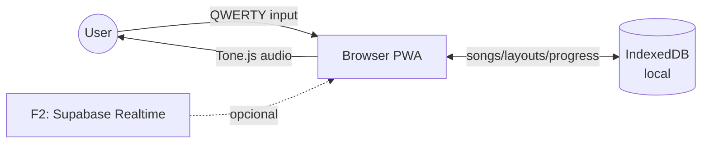
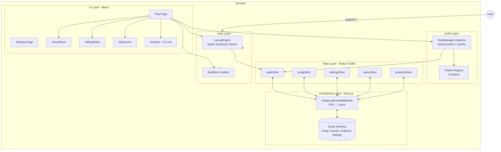
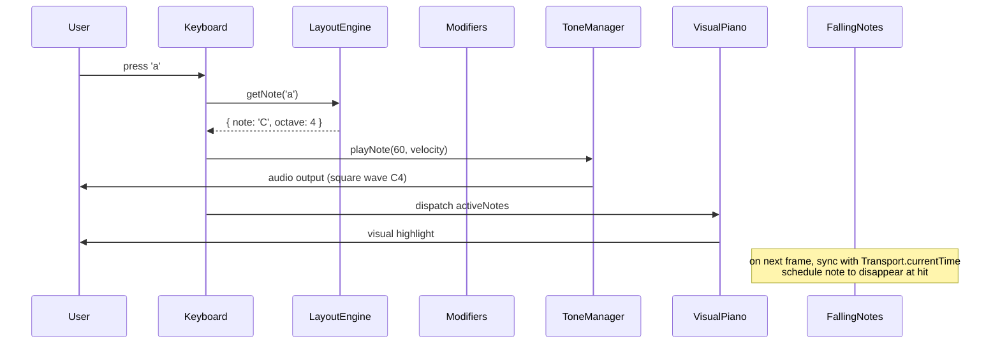

# Diagramas de Componentes (Flowcharts)

Propósito: mapa estable del sistema. Actualizar solo si cambia topología.

## Contexto (alto nivel)

F1 es frontend-only, local-first. F2 agrega sync opcional. F3 expande con AI.

## Componentes principales (F1)

## Flujo crítico: tocar una nota

## Disciplina clave (ver CLAUDE.md)

1. **ToneManager NO en Redux** — singleton fuera del store
2. **Timing = `Tone.Transport.currentTime`** — single source of truth
3. **Hydration RTK ↔ Dexie** — via `createListenerMiddleware`
